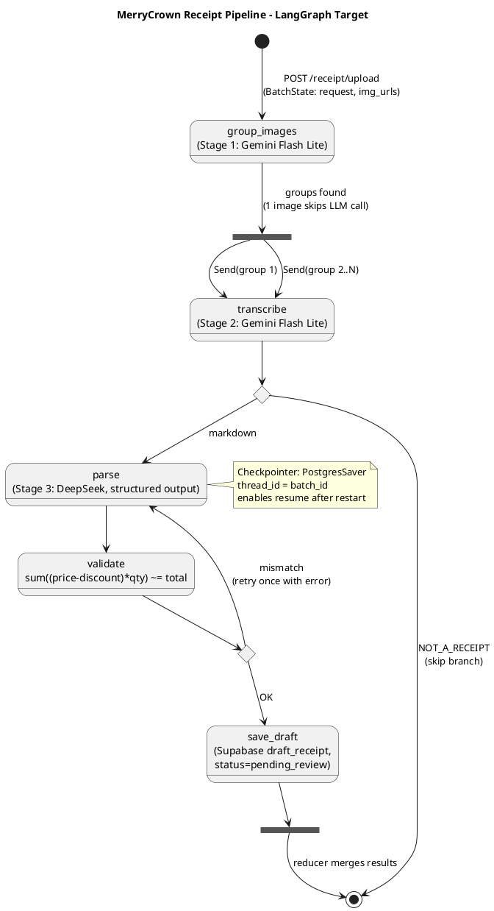
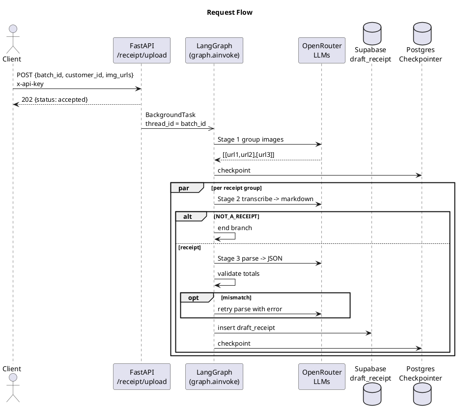
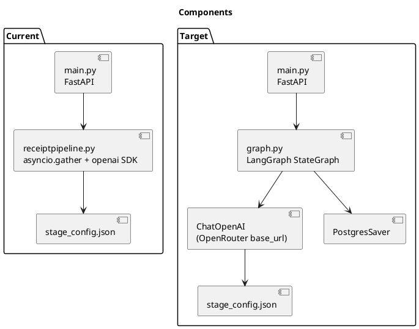

# LangGraph Migration Diagrams

## 1. Target graph (state machine)

## 2. Sequence (request flow)

## 3. Current vs target components

> Render with the VS Code "PlantUML" extension, IntelliJ's PlantUML plugin, or paste each block into https://www.plantuml.com/plantuml.
